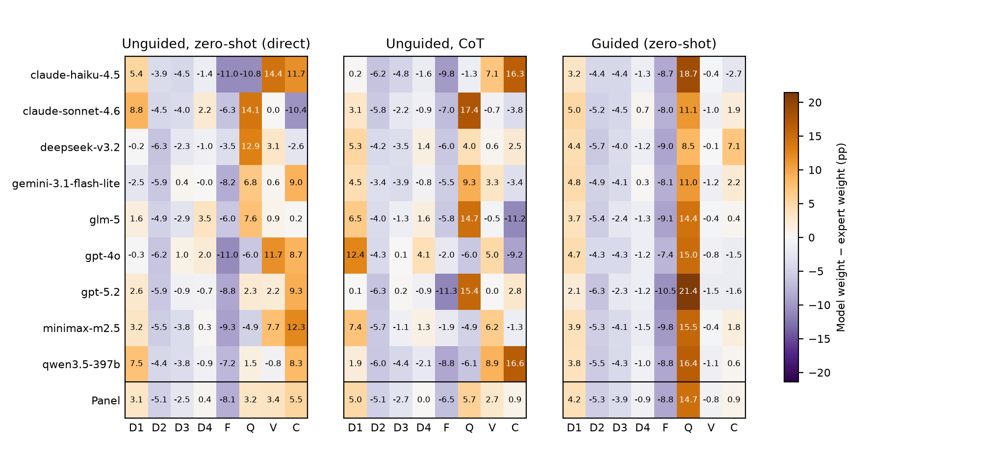
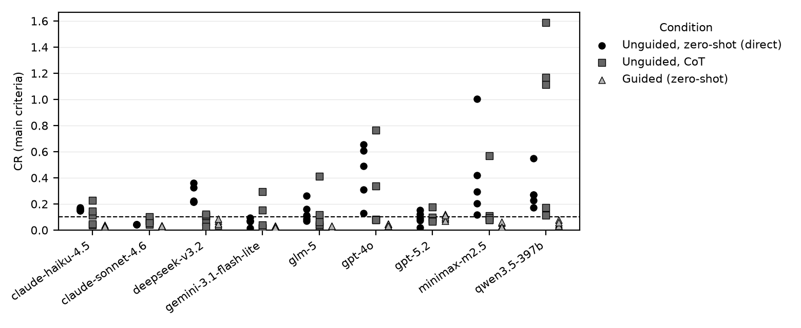

# LLM-AHP report (run tag: main)

Input: `calls.jsonl`; records with this tag: 270; selected matrices: 270; failed or unusable records: 0; unreadable lines skipped: 0.

Rounding: weights and CR 4 dp, correlations 3 dp, percentage points 2 dp. Empty cells mean no data. Agreement with the expert weights is a similarity measure, not a quality measure.

## Conditions

Conditions are described on two axes: prompting technique (zero-shot = no worked examples and no reasoning instruction; chain-of-thought = an instruction to reason step by step) and weight guidance (guided = the prompt states a priority order and importance hints; unguided = neutral questions). Short labels: guided, direct (stored key `lean`) and CoT (stored key `cot`).

| Technique / guidance | Guided | Unguided |
| --- | --- | --- |
| Zero-shot | Guided (zero-shot): `guided` | Unguided, zero-shot (direct): `lean` |
| Chain-of-thought | not run | Unguided, CoT: `cot` |

| Prompt content | Guided (zero-shot) | Unguided, zero-shot (direct) | Unguided, CoT |
| --- | --- | --- | --- |
| Role line | AHP expert specialised in supplier evaluation, with AHP rules | procurement professional with experience in supplier evaluation | same as direct |
| Priority order | yes: typical priority order (Quality highest ... Volume lower); "never use all 1s" | no | no |
| Criterion hints | yes: importance-laden descriptions of the criteria (in Turkish) | no (names only) | no (names only) |
| KPI report | yes: data report on the suppliers (in Turkish) | no | no |
| Reasoning instruction | rationale per comparison requested | none | reason step by step and state a ranking before answering |
| Reply format | full pairwise matrix with labels and rationales (JSON) | one value per question (JSON) | reasoning, ranking and one value per question (JSON) |

## T01 Models and settings

Lists each model with its developer, OpenRouter identifier, requested temperature, applied reasoning setting, mean reasoning tokens, providers seen, number of calls, number of parse failures and total cost (USD) for the selected run tag.

| Model | Developer | OpenRouter id | Temperature (requested) | Reasoning (applied) | Mean reasoning tokens | Providers seen | Calls | Parse failures | Total cost (USD) |
| --- | --- | --- | --- | --- | ---: | --- | ---: | ---: | ---: |
| claude-haiku-4.5 | Anthropic | anthropic/claude-haiku-4.5 | 0.6 | effort=none | 0.0 | Amazon Bedrock | 30 | 0 | 0.2046 |
| claude-sonnet-4.6 | Anthropic | anthropic/claude-sonnet-4.6 | 0.6 | effort=none | 0.0 | Claude Platform on AWS | 30 | 0 | 0.6426 |
| deepseek-v3.2 | DeepSeek | deepseek/deepseek-v3.2 | 0.6 | effort=none | 0.0 | Baidu; DeepInfra; DigitalOcean | 30 | 0 | 0.0191 |
| gemini-3.1-flash-lite | Google | google/gemini-3.1-flash-lite | 0.6 | effort=none | 0.0 | Google | 30 | 0 | 0.0224 |
| glm-5 | Zhipu AI | z-ai/glm-5 | 0.6 | effort=none | 0.0 | Amazon Bedrock; Baidu; Novita; SiliconFlow; StreamLake; Z.AI | 30 | 0 | 0.0697 |
| gpt-4o | OpenAI | openai/gpt-4o | 0.6 | omitted | 0.0 | OpenAI | 30 | 0 | 0.1869 |
| gpt-5.2 | OpenAI | openai/gpt-5.2 | 0.6 | effort=none | 0.0 | OpenAI | 30 | 0 | 0.2215 |
| minimax-m2.5 | MiniMax | minimax/minimax-m2.5 | 0.6 | effort=minimal | 691.6 | DigitalOcean | 30 | 0 | 0.0453 |
| qwen3.5-397b | Alibaba Cloud | qwen/qwen3.5-397b-a17b | 0.6 | effort=none | 0.0 | Alibaba; Parasail; StreamLake | 30 | 0 | 0.0663 |

## T02 Expert consistency

Gives the consistency ratio (CR) of each expert's main-criteria and delivery sub-criteria matrix, the CR of the geometric-mean group matrices, and the number of matrices with CR ≤ 0.10.

| Expert | CR main | CR delivery |
| --- | ---: | ---: |
| E1 | 0.1484 | 0.4938 |
| E2 | 0.3932 | 0.3191 |
| E3 | 0.0828 | 0.2362 |
| E4 | 0.0142 | 0.1861 |
| E5 | 0.0621 | 0.3722 |
| E6 | 0.0841 | 0.1228 |
| E7 | 0.1733 | 0.1140 |
| Group (geometric mean) | 0.0321 | 0.0208 |
| n with CR ≤ 0.10 | 4/7 | 0/7 |

## T03 LLM consistency

Gives, per model and condition, the mean and maximum CR over repetitions and the number of matrices with CR ≤ 0.10 for the main and delivery tasks; panel rows pool all models and add the CR of the geometric-mean group matrix.

| Model | Guidance | Technique | Condition | Mean CR main | Max CR main | CR ≤ 0.10 main | Group CR main | Mean CR delivery | Max CR delivery | CR ≤ 0.10 delivery | Group CR delivery |
| --- | --- | --- | --- | ---: | ---: | --- | ---: | ---: | ---: | --- | ---: |
| claude-haiku-4.5 | unguided | zero-shot | direct | 0.1576 | 0.1723 | 0/5 |  | 0.0951 | 0.1770 | 4/5 |  |
| claude-haiku-4.5 | unguided | CoT | CoT | 0.1150 | 0.2285 | 2/5 |  | 0.0962 | 0.1971 | 3/5 |  |
| claude-haiku-4.5 | guided | zero-shot | guided | 0.0272 | 0.0390 | 5/5 |  | 0.0233 | 0.0244 | 5/5 |  |
| claude-sonnet-4.6 | unguided | zero-shot | direct | 0.0418 | 0.0418 | 5/5 |  | 0.0753 | 0.0845 | 5/5 |  |
| claude-sonnet-4.6 | unguided | CoT | CoT | 0.0682 | 0.1018 | 4/5 |  | 0.0489 | 0.0751 | 5/5 |  |
| claude-sonnet-4.6 | guided | zero-shot | guided | 0.0284 | 0.0334 | 5/5 |  | 0.0331 | 0.0386 | 5/5 |  |
| deepseek-v3.2 | unguided | zero-shot | direct | 0.2683 | 0.3621 | 0/5 |  | 0.1298 | 0.2666 | 3/5 |  |
| deepseek-v3.2 | unguided | CoT | CoT | 0.0871 | 0.1226 | 2/5 |  | 0.1122 | 0.3211 | 4/5 |  |
| deepseek-v3.2 | guided | zero-shot | guided | 0.0585 | 0.0863 | 5/5 |  | 0.0304 | 0.0386 | 5/5 |  |
| gemini-3.1-flash-lite | unguided | zero-shot | direct | 0.0631 | 0.0927 | 5/5 |  | 0.9659 | 1.1946 | 0/5 |  |
| gemini-3.1-flash-lite | unguided | CoT | CoT | 0.1037 | 0.2954 | 3/5 |  | 0.0495 | 0.1343 | 4/5 |  |
| gemini-3.1-flash-lite | guided | zero-shot | guided | 0.0280 | 0.0303 | 5/5 |  | 0.0093 | 0.0168 | 5/5 |  |
| glm-5 | unguided | zero-shot | direct | 0.1391 | 0.2640 | 2/5 |  | 0.1210 | 0.4085 | 4/5 |  |
| glm-5 | unguided | CoT | CoT | 0.1342 | 0.4129 | 3/5 |  | 0.0800 | 0.1030 | 4/5 |  |
| glm-5 | guided | zero-shot | guided | 0.0249 | 0.0321 | 5/5 |  | 0.0193 | 0.0284 | 5/5 |  |
| gpt-4o | unguided | zero-shot | direct | 0.4381 | 0.6545 | 0/5 |  | 0.6789 | 0.8967 | 0/5 |  |
| gpt-4o | unguided | CoT | CoT | 0.2681 | 0.7627 | 3/5 |  | 0.2018 | 0.2655 | 0/5 |  |
| gpt-4o | guided | zero-shot | guided | 0.0398 | 0.0475 | 5/5 |  | 0.0256 | 0.0357 | 5/5 |  |
| gpt-5.2 | unguided | zero-shot | direct | 0.0917 | 0.1528 | 3/5 |  | 0.1258 | 0.2163 | 3/5 |  |
| gpt-5.2 | unguided | CoT | CoT | 0.0983 | 0.1759 | 4/5 |  | 0.1055 | 0.1790 | 3/5 |  |
| gpt-5.2 | guided | zero-shot | guided | 0.0974 | 0.1230 | 3/5 |  | 0.0189 | 0.0189 | 5/5 |  |
| minimax-m2.5 | unguided | zero-shot | direct | 0.4071 | 1.0032 | 0/5 |  | 0.3180 | 0.9386 | 2/5 |  |
| minimax-m2.5 | unguided | CoT | CoT | 0.1854 | 0.5681 | 3/5 |  | 0.0526 | 0.0668 | 5/5 |  |
| minimax-m2.5 | guided | zero-shot | guided | 0.0394 | 0.0610 | 5/5 |  | 0.0351 | 0.0415 | 5/5 |  |
| qwen3.5-397b | unguided | zero-shot | direct | 0.2967 | 0.5477 | 0/5 |  | 0.1612 | 0.4024 | 2/5 |  |
| qwen3.5-397b | unguided | CoT | CoT | 0.8310 | 1.5878 | 0/5 |  | 0.1245 | 0.1561 | 1/5 |  |
| qwen3.5-397b | guided | zero-shot | guided | 0.0478 | 0.0778 | 5/5 |  | 0.0319 | 0.0453 | 5/5 |  |
| Panel | unguided | zero-shot | direct | 0.2115 | 1.0032 | 15/45 | 0.0616 | 0.2968 | 1.1946 | 23/45 | 0.0866 |
| Panel | unguided | CoT | CoT | 0.2101 | 1.5878 | 24/45 | 0.0228 | 0.0968 | 0.3211 | 29/45 | 0.0075 |
| Panel | guided | zero-shot | guided | 0.0435 | 0.1230 | 43/45 | 0.0315 | 0.0252 | 0.0453 | 45/45 | 0.0033 |

## T04 Main-criteria weights

Lists the expert group weights and each condition's LLM panel group weights for the five main criteria, with the LLM minus expert difference in percentage points.

| Criterion | Experts | LLM unguided_direct | Diff unguided_direct (pp) | LLM unguided_cot | Diff unguided_cot (pp) | LLM guided | Diff guided (pp) |
| --- | ---: | ---: | ---: | ---: | ---: | ---: | ---: |
| Delivery and Operational Performance | 0.2147 | 0.1744 | -4.02 | 0.1864 | -2.83 | 0.1555 | -5.91 |
| Financial Performance | 0.1604 | 0.0796 | -8.08 | 0.0950 | -6.54 | 0.0721 | -8.84 |
| Quality Performance | 0.3186 | 0.3507 | 3.22 | 0.3757 | 5.72 | 0.4651 | 14.65 |
| Volume and Logistics | 0.0529 | 0.0870 | 3.41 | 0.0800 | 2.71 | 0.0451 | -0.78 |
| Compliance and Reliability | 0.2535 | 0.3083 | 5.48 | 0.2629 | 0.94 | 0.2622 | 0.87 |

## T05 Delivery local weights

Lists the expert group weights and each condition's LLM panel group weights for the four delivery sub-criteria (local weights), with the LLM minus expert difference in percentage points.

| Criterion | Experts | LLM unguided_direct | Diff unguided_direct (pp) | LLM unguided_cot | Diff unguided_cot (pp) | LLM guided | Diff guided (pp) |
| --- | ---: | ---: | ---: | ---: | ---: | ---: | ---: |
| D1 Delivered | 0.2512 | 0.4890 | 23.77 | 0.5568 | 30.56 | 0.6153 | 36.41 |
| D2 Pending | 0.3471 | 0.1329 | -21.43 | 0.1243 | -22.28 | 0.1414 | -20.58 |
| D3 Cancelled | 0.2560 | 0.1732 | -8.28 | 0.1509 | -10.51 | 0.1005 | -15.55 |
| D4 Partially delivered | 0.1457 | 0.2050 | 5.93 | 0.1680 | 2.23 | 0.1429 | -0.28 |

## T06 Global weights

Lists the expert group weights and each condition's LLM panel group weights for the eight global indicators, with the LLM minus expert difference in percentage points.

| Criterion | Experts | LLM unguided_direct | Diff unguided_direct (pp) | LLM unguided_cot | Diff unguided_cot (pp) | LLM guided | Diff guided (pp) |
| --- | ---: | ---: | ---: | ---: | ---: | ---: | ---: |
| D1 Delivered | 0.0539 | 0.0853 | 3.14 | 0.1038 | 4.99 | 0.0957 | 4.18 |
| D2 Pending | 0.0745 | 0.0232 | -5.13 | 0.0232 | -5.13 | 0.0220 | -5.25 |
| D3 Cancelled | 0.0550 | 0.0302 | -2.47 | 0.0281 | -2.68 | 0.0156 | -3.93 |
| D4 Partially delivered | 0.0313 | 0.0358 | 0.45 | 0.0313 | 0.00 | 0.0222 | -0.90 |
| F Financial | 0.1604 | 0.0796 | -8.08 | 0.0950 | -6.54 | 0.0721 | -8.84 |
| Q Quality | 0.3186 | 0.3507 | 3.22 | 0.3757 | 5.72 | 0.4651 | 14.65 |
| V Volume | 0.0529 | 0.0870 | 3.41 | 0.0800 | 2.71 | 0.0451 | -0.78 |
| C Compliance | 0.2535 | 0.3083 | 5.48 | 0.2629 | 0.94 | 0.2622 | 0.87 |

## T07 Model-level main weights

Gives, per model and condition, the main-criteria weights from the geometric mean of the model's repetition matrices, the number of repetitions used and the top-ranked criterion.

| Model | Guidance | Technique | Condition | Reps | Delivery | Financial | Quality | Volume | Compliance | Top criterion |
| --- | --- | --- | --- | ---: | ---: | ---: | ---: | ---: | ---: | --- |
| claude-haiku-4.5 | unguided | zero-shot | direct | 5 | 0.1715 | 0.0507 | 0.2110 | 0.1966 | 0.3702 | Compliance |
| claude-haiku-4.5 | unguided | CoT | CoT | 5 | 0.0909 | 0.0625 | 0.3060 | 0.1239 | 0.4167 | Compliance |
| claude-haiku-4.5 | guided | zero-shot | guided | 5 | 0.1455 | 0.0735 | 0.5057 | 0.0484 | 0.2269 | Quality |
| claude-sonnet-4.6 | unguided | zero-shot | direct | 5 | 0.2410 | 0.0970 | 0.4592 | 0.0531 | 0.1497 | Quality |
| claude-sonnet-4.6 | unguided | CoT | CoT | 5 | 0.1560 | 0.0906 | 0.4921 | 0.0457 | 0.2156 | Quality |
| claude-sonnet-4.6 | guided | zero-shot | guided | 5 | 0.1754 | 0.0801 | 0.4294 | 0.0426 | 0.2724 | Quality |
| deepseek-v3.2 | unguided | zero-shot | direct | 5 | 0.1160 | 0.1252 | 0.4478 | 0.0837 | 0.2273 | Quality |
| deepseek-v3.2 | unguided | CoT | CoT | 5 | 0.2039 | 0.1004 | 0.3589 | 0.0586 | 0.2782 | Quality |
| deepseek-v3.2 | guided | zero-shot | guided | 5 | 0.1497 | 0.0702 | 0.4033 | 0.0523 | 0.3245 | Quality |
| gemini-3.1-flash-lite | unguided | zero-shot | direct | 5 | 0.1337 | 0.0780 | 0.3864 | 0.0584 | 0.3435 | Quality |
| gemini-3.1-flash-lite | unguided | CoT | CoT | 5 | 0.1779 | 0.1055 | 0.4118 | 0.0856 | 0.2192 | Quality |
| gemini-3.1-flash-lite | guided | zero-shot | guided | 5 | 0.1755 | 0.0793 | 0.4284 | 0.0412 | 0.2755 | Quality |
| glm-5 | unguided | zero-shot | direct | 5 | 0.1879 | 0.1003 | 0.3948 | 0.0617 | 0.2554 | Quality |
| glm-5 | unguided | CoT | CoT | 5 | 0.2434 | 0.1025 | 0.4651 | 0.0477 | 0.1413 | Quality |
| glm-5 | guided | zero-shot | guided | 5 | 0.1615 | 0.0696 | 0.4625 | 0.0485 | 0.2579 | Quality |
| gpt-4o | unguided | zero-shot | direct | 5 | 0.1809 | 0.0501 | 0.2587 | 0.1697 | 0.3406 | Compliance |
| gpt-4o | unguided | CoT | CoT | 5 | 0.3371 | 0.1400 | 0.2590 | 0.1025 | 0.1615 | Delivery |
| gpt-4o | guided | zero-shot | guided | 5 | 0.1633 | 0.0859 | 0.4681 | 0.0445 | 0.2382 | Quality |
| gpt-5.2 | unguided | zero-shot | direct | 5 | 0.1648 | 0.0721 | 0.3416 | 0.0745 | 0.3470 | Compliance |
| gpt-5.2 | unguided | CoT | CoT | 5 | 0.1457 | 0.0472 | 0.4728 | 0.0531 | 0.2811 | Quality |
| gpt-5.2 | guided | zero-shot | guided | 5 | 0.1367 | 0.0559 | 0.5329 | 0.0374 | 0.2372 | Quality |
| minimax-m2.5 | unguided | zero-shot | direct | 5 | 0.1562 | 0.0673 | 0.2699 | 0.1301 | 0.3765 | Compliance |
| minimax-m2.5 | unguided | CoT | CoT | 5 | 0.2329 | 0.1416 | 0.2698 | 0.1150 | 0.2408 | Quality |
| minimax-m2.5 | guided | zero-shot | guided | 5 | 0.1444 | 0.0625 | 0.4736 | 0.0484 | 0.2711 | Quality |
| qwen3.5-397b | unguided | zero-shot | direct | 5 | 0.1982 | 0.0881 | 0.3332 | 0.0446 | 0.3360 | Compliance |
| qwen3.5-397b | unguided | CoT | CoT | 5 | 0.1086 | 0.0726 | 0.2578 | 0.1417 | 0.4193 | Compliance |
| qwen3.5-397b | guided | zero-shot | guided | 5 | 0.1439 | 0.0725 | 0.4828 | 0.0418 | 0.2590 | Quality |

## T08 Similarity to expert weights

Gives Spearman rho, Kendall tau, RMSE and mean absolute difference (percentage points) between each model's (and each condition panel's) group weights and the expert group weights, for the five main and the eight global weights.

| Model | Guidance | Technique | Condition | Spearman rho main | Kendall tau main | RMSE (pp) main | Mean abs diff (pp) main | Spearman rho global | Kendall tau global | RMSE (pp) global | Mean abs diff (pp) global |
| --- | --- | --- | --- | ---: | ---: | ---: | ---: | ---: | ---: | ---: | ---: |
| claude-haiku-4.5 | unguided | zero-shot | direct | 0.600 | 0.400 | 10.93 | 10.42 | 0.524 | 0.357 | 8.98 | 7.86 |
| claude-haiku-4.5 | unguided | CoT | CoT | 0.600 | 0.400 | 10.65 | 9.37 | 0.500 | 0.357 | 7.73 | 5.91 |
| claude-haiku-4.5 | guided | zero-shot | guided | 1.000 | 1.000 | 9.81 | 7.49 | 0.667 | 0.571 | 7.78 | 5.49 |
| claude-sonnet-4.6 | unguided | zero-shot | direct | 0.900 | 0.800 | 8.40 | 6.69 | 0.548 | 0.429 | 7.62 | 6.28 |
| claude-sonnet-4.6 | unguided | CoT | CoT | 1.000 | 1.000 | 8.93 | 6.94 | 0.690 | 0.571 | 7.20 | 5.13 |
| claude-sonnet-4.6 | guided | zero-shot | guided | 1.000 | 1.000 | 6.44 | 5.19 | 0.571 | 0.500 | 5.75 | 4.67 |
| deepseek-v3.2 | unguided | zero-shot | direct | 0.900 | 0.800 | 7.66 | 6.40 | 0.667 | 0.500 | 5.50 | 4.00 |
| deepseek-v3.2 | unguided | CoT | CoT | 1.000 | 1.000 | 3.46 | 2.83 | 0.571 | 0.500 | 3.85 | 3.43 |
| deepseek-v3.2 | guided | zero-shot | guided | 1.000 | 1.000 | 7.01 | 6.23 | 0.571 | 0.500 | 5.85 | 5.01 |
| gemini-3.1-flash-lite | unguided | zero-shot | direct | 1.000 | 1.000 | 7.22 | 6.54 | 0.690 | 0.571 | 5.44 | 4.17 |
| gemini-3.1-flash-lite | unguided | CoT | CoT | 1.000 | 1.000 | 5.53 | 5.04 | 0.738 | 0.643 | 4.83 | 4.26 |
| gemini-3.1-flash-lite | guided | zero-shot | guided | 1.000 | 1.000 | 6.45 | 5.28 | 0.571 | 0.500 | 5.67 | 4.58 |
| glm-5 | unguided | zero-shot | direct | 1.000 | 1.000 | 4.52 | 3.48 | 0.595 | 0.429 | 4.21 | 3.44 |
| glm-5 | unguided | CoT | CoT | 0.900 | 0.800 | 8.75 | 7.01 | 0.548 | 0.429 | 7.39 | 5.70 |
| glm-5 | guided | zero-shot | guided | 1.000 | 1.000 | 7.98 | 5.93 | 0.714 | 0.571 | 6.52 | 4.64 |
| gpt-4o | unguided | zero-shot | direct | 0.800 | 0.600 | 8.73 | 8.16 | 0.286 | 0.143 | 7.19 | 5.86 |
| gpt-4o | unguided | CoT | CoT | 0.700 | 0.600 | 7.73 | 6.88 | 0.452 | 0.357 | 6.51 | 5.39 |
| gpt-4o | guided | zero-shot | guided | 1.000 | 1.000 | 7.86 | 5.98 | 0.667 | 0.571 | 6.54 | 4.91 |
| gpt-5.2 | unguided | zero-shot | direct | 0.800 | 0.600 | 6.33 | 5.53 | 0.500 | 0.357 | 5.22 | 4.10 |
| gpt-5.2 | unguided | CoT | CoT | 0.900 | 0.800 | 9.18 | 7.28 | 0.548 | 0.500 | 7.20 | 4.63 |
| gpt-5.2 | guided | zero-shot | guided | 1.000 | 1.000 | 11.26 | 8.57 | 0.619 | 0.500 | 8.84 | 5.88 |
| minimax-m2.5 | unguided | zero-shot | direct | 0.800 | 0.600 | 8.43 | 8.01 | 0.429 | 0.286 | 6.86 | 5.87 |
| minimax-m2.5 | unguided | CoT | CoT | 1.000 | 1.000 | 3.76 | 3.21 | 0.619 | 0.500 | 4.44 | 3.72 |
| minimax-m2.5 | guided | zero-shot | guided | 1.000 | 1.000 | 8.82 | 6.90 | 0.667 | 0.571 | 7.09 | 5.30 |
| qwen3.5-397b | unguided | zero-shot | direct | 0.900 | 0.800 | 5.02 | 3.89 | 0.643 | 0.500 | 5.17 | 4.29 |
| qwen3.5-397b | unguided | CoT | CoT | 0.600 | 0.400 | 10.78 | 10.19 | 0.595 | 0.429 | 8.15 | 6.84 |
| qwen3.5-397b | guided | zero-shot | guided | 1.000 | 1.000 | 8.93 | 6.79 | 0.571 | 0.500 | 7.19 | 5.19 |
| Panel | unguided | zero-shot | direct | 0.900 | 0.800 | 5.17 | 4.84 | 0.429 | 0.286 | 4.47 | 3.92 |
| Panel | unguided | CoT | CoT | 1.000 | 1.000 | 4.28 | 3.75 | 0.548 | 0.429 | 4.22 | 3.59 |
| Panel | guided | zero-shot | guided | 1.000 | 1.000 | 8.11 | 6.21 | 0.571 | 0.500 | 6.67 | 4.93 |

## T09 Run-to-run stability

Gives, per model and condition, the sample standard deviation and coefficient of variation of each main-criteria weight across repetitions, their mean CV, and the number of distinct top-ranked criteria across repetitions.

| Model | Guidance | Technique | Condition | Reps | SD Delivery | SD Financial | SD Quality | SD Volume | SD Compliance | CV Delivery | CV Financial | CV Quality | CV Volume | CV Compliance | Mean CV | Distinct top criteria |
| --- | --- | --- | --- | ---: | ---: | ---: | ---: | ---: | ---: | ---: | ---: | ---: | ---: | ---: | ---: | ---: |
| claude-haiku-4.5 | unguided | zero-shot | direct | 5 | 0.0038 | 0.0051 | 0.0047 | 0.0244 | 0.0291 | 0.023 | 0.100 | 0.022 | 0.124 | 0.078 | 0.069 | 1 |
| claude-haiku-4.5 | unguided | CoT | CoT | 5 | 0.0338 | 0.0220 | 0.1093 | 0.0219 | 0.0968 | 0.365 | 0.350 | 0.354 | 0.186 | 0.232 | 0.297 | 2 |
| claude-haiku-4.5 | guided | zero-shot | guided | 5 | 0.0205 | 0.0060 | 0.0456 | 0.0033 | 0.0300 | 0.141 | 0.082 | 0.090 | 0.068 | 0.132 | 0.103 | 1 |
| claude-sonnet-4.6 | unguided | zero-shot | direct | 5 | 0.0000 | 0.0000 | 0.0000 | 0.0000 | 0.0000 | 0.000 | 0.000 | 0.000 | 0.000 | 0.000 | 0.000 | 1 |
| claude-sonnet-4.6 | unguided | CoT | CoT | 5 | 0.0541 | 0.0291 | 0.0196 | 0.0055 | 0.0415 | 0.328 | 0.307 | 0.041 | 0.123 | 0.191 | 0.198 | 1 |
| claude-sonnet-4.6 | guided | zero-shot | guided | 5 | 0.0023 | 0.0026 | 0.0028 | 0.0032 | 0.0029 | 0.013 | 0.033 | 0.007 | 0.074 | 0.011 | 0.028 | 1 |
| deepseek-v3.2 | unguided | zero-shot | direct | 5 | 0.0457 | 0.0564 | 0.0241 | 0.0287 | 0.0514 | 0.408 | 0.428 | 0.056 | 0.347 | 0.214 | 0.291 | 1 |
| deepseek-v3.2 | unguided | CoT | CoT | 5 | 0.0438 | 0.0112 | 0.1181 | 0.0128 | 0.1482 | 0.225 | 0.118 | 0.337 | 0.227 | 0.489 | 0.279 | 2 |
| deepseek-v3.2 | guided | zero-shot | guided | 5 | 0.0281 | 0.0103 | 0.0764 | 0.0258 | 0.0699 | 0.192 | 0.149 | 0.190 | 0.474 | 0.213 | 0.243 | 2 |
| gemini-3.1-flash-lite | unguided | zero-shot | direct | 5 | 0.0175 | 0.0084 | 0.0272 | 0.0021 | 0.0535 | 0.132 | 0.108 | 0.071 | 0.036 | 0.153 | 0.100 | 2 |
| gemini-3.1-flash-lite | unguided | CoT | CoT | 5 | 0.0209 | 0.0056 | 0.0450 | 0.0458 | 0.0907 | 0.121 | 0.055 | 0.113 | 0.481 | 0.395 | 0.233 | 2 |
| gemini-3.1-flash-lite | guided | zero-shot | guided | 5 | 0.0007 | 0.0032 | 0.0010 | 0.0015 | 0.0005 | 0.004 | 0.040 | 0.002 | 0.037 | 0.002 | 0.017 | 1 |
| glm-5 | unguided | zero-shot | direct | 5 | 0.0644 | 0.0604 | 0.0934 | 0.0338 | 0.1551 | 0.345 | 0.565 | 0.257 | 0.517 | 0.560 | 0.449 | 2 |
| glm-5 | unguided | CoT | CoT | 5 | 0.0209 | 0.0872 | 0.1070 | 0.0075 | 0.0080 | 0.089 | 0.707 | 0.234 | 0.162 | 0.058 | 0.250 | 2 |
| glm-5 | guided | zero-shot | guided | 5 | 0.0184 | 0.0135 | 0.0426 | 0.0178 | 0.0253 | 0.114 | 0.191 | 0.092 | 0.352 | 0.099 | 0.170 | 1 |
| gpt-4o | unguided | zero-shot | direct | 5 | 0.0854 | 0.0190 | 0.0599 | 0.0462 | 0.0824 | 0.435 | 0.411 | 0.239 | 0.253 | 0.254 | 0.319 | 3 |
| gpt-4o | unguided | CoT | CoT | 5 | 0.1390 | 0.0709 | 0.0718 | 0.0492 | 0.0659 | 0.410 | 0.488 | 0.303 | 0.427 | 0.403 | 0.406 | 2 |
| gpt-4o | guided | zero-shot | guided | 5 | 0.0156 | 0.0038 | 0.0394 | 0.0042 | 0.0282 | 0.096 | 0.044 | 0.084 | 0.095 | 0.118 | 0.087 | 1 |
| gpt-5.2 | unguided | zero-shot | direct | 5 | 0.0234 | 0.0159 | 0.0539 | 0.0174 | 0.0596 | 0.144 | 0.215 | 0.159 | 0.227 | 0.172 | 0.183 | 2 |
| gpt-5.2 | unguided | CoT | CoT | 5 | 0.0073 | 0.0228 | 0.0852 | 0.0214 | 0.0892 | 0.052 | 0.442 | 0.182 | 0.376 | 0.317 | 0.274 | 2 |
| gpt-5.2 | guided | zero-shot | guided | 5 | 0.0266 | 0.0048 | 0.0416 | 0.0093 | 0.0236 | 0.193 | 0.086 | 0.078 | 0.245 | 0.100 | 0.140 | 1 |
| minimax-m2.5 | unguided | zero-shot | direct | 5 | 0.0197 | 0.0643 | 0.0986 | 0.0622 | 0.1280 | 0.137 | 0.740 | 0.376 | 0.418 | 0.357 | 0.406 | 2 |
| minimax-m2.5 | unguided | CoT | CoT | 5 | 0.1161 | 0.0850 | 0.1826 | 0.0630 | 0.1379 | 0.503 | 0.566 | 0.642 | 0.574 | 0.613 | 0.580 | 3 |
| minimax-m2.5 | guided | zero-shot | guided | 5 | 0.0162 | 0.0115 | 0.0253 | 0.0181 | 0.0346 | 0.113 | 0.182 | 0.054 | 0.358 | 0.127 | 0.167 | 1 |
| qwen3.5-397b | unguided | zero-shot | direct | 5 | 0.0389 | 0.0138 | 0.0455 | 0.0331 | 0.0763 | 0.193 | 0.158 | 0.138 | 0.646 | 0.230 | 0.273 | 2 |
| qwen3.5-397b | unguided | CoT | CoT | 5 | 0.0318 | 0.0284 | 0.0154 | 0.1037 | 0.1476 | 0.295 | 0.341 | 0.064 | 0.599 | 0.374 | 0.335 | 2 |
| qwen3.5-397b | guided | zero-shot | guided | 5 | 0.0239 | 0.0107 | 0.0471 | 0.0031 | 0.0153 | 0.165 | 0.147 | 0.098 | 0.075 | 0.059 | 0.109 | 1 |

## T10 Panel composition variants

Gives, per condition, the panel main-criteria group weights and their similarity to the expert weights (main and global) for all models, one model per developer (claude-haiku-4.5 and gpt-5.2 removed) and the panel without gpt-5.2.

| Guidance | Technique | Condition | Panel | Models | Delivery | Financial | Quality | Volume | Compliance | Spearman rho main | Kendall tau main | RMSE (pp) main | Mean abs diff (pp) main | Spearman rho global | Kendall tau global | RMSE (pp) global | Mean abs diff (pp) global |
| --- | --- | --- | --- | ---: | ---: | ---: | ---: | ---: | ---: | ---: | ---: | ---: | ---: | ---: | ---: | ---: | ---: |
| unguided | zero-shot | direct | All models | 9 | 0.1744 | 0.0796 | 0.3507 | 0.0870 | 0.3083 | 0.900 | 0.800 | 5.17 | 4.84 | 0.429 | 0.286 | 4.47 | 3.92 |
| unguided | zero-shot | direct | One per developer | 7 | 0.1736 | 0.0844 | 0.3723 | 0.0788 | 0.2908 | 1.000 | 1.000 | 4.98 | 4.68 | 0.619 | 0.500 | 4.30 | 3.80 |
| unguided | zero-shot | direct | Without gpt-5.2 | 8 | 0.1756 | 0.0804 | 0.3518 | 0.0891 | 0.3032 | 0.900 | 0.800 | 5.06 | 4.77 | 0.429 | 0.286 | 4.41 | 3.92 |
| unguided | CoT | CoT | All models | 9 | 0.1864 | 0.0950 | 0.3757 | 0.0800 | 0.2629 | 1.000 | 1.000 | 4.28 | 3.75 | 0.548 | 0.429 | 4.22 | 3.59 |
| unguided | CoT | CoT | One per developer | 7 | 0.2087 | 0.1100 | 0.3647 | 0.0783 | 0.2383 | 1.000 | 1.000 | 3.34 | 2.86 | 0.548 | 0.429 | 3.97 | 3.48 |
| unguided | CoT | CoT | Without gpt-5.2 | 8 | 0.1910 | 0.1030 | 0.3627 | 0.0834 | 0.2599 | 1.000 | 1.000 | 3.68 | 3.24 | 0.548 | 0.429 | 3.98 | 3.43 |
| guided | zero-shot | guided | All models | 9 | 0.1555 | 0.0721 | 0.4651 | 0.0451 | 0.2622 | 1.000 | 1.000 | 8.11 | 6.21 | 0.571 | 0.500 | 6.67 | 4.93 |
| guided | zero-shot | guided | One per developer | 7 | 0.1597 | 0.0743 | 0.4494 | 0.0457 | 0.2708 | 1.000 | 1.000 | 7.47 | 5.93 | 0.571 | 0.500 | 6.26 | 4.84 |
| guided | zero-shot | guided | Without gpt-5.2 | 8 | 0.1580 | 0.0743 | 0.4564 | 0.0461 | 0.2651 | 1.000 | 1.000 | 7.72 | 5.98 | 0.667 | 0.571 | 6.41 | 4.84 |

## T11 Supplier rankings (rates)

Gives TOPSIS, ARAS and EDAS scores and ranks of the suppliers under the expert global weights and each condition's LLM panel global weights, with delivery indicators as rates.

| Weights | Supplier | TOPSIS score | TOPSIS rank | ARAS score | ARAS rank | EDAS score | EDAS rank |
| --- | --- | ---: | ---: | ---: | ---: | ---: | ---: |
| Experts | Alpha_Inc | 0.9035 | 2 | 0.7063 | 2 | 0.9928 | 1 |
| Experts | Beta_Supplies | 0.3720 | 4 | 0.3476 | 4 | 0.3116 | 4 |
| Experts | Delta_Logistics | 0.0268 | 5 | 0.3142 | 5 | 0.0040 | 5 |
| Experts | Epsilon_Group | 0.9180 | 1 | 0.8473 | 1 | 0.9858 | 2 |
| Experts | Gamma_Co | 0.6890 | 3 | 0.4498 | 3 | 0.6512 | 3 |
| LLM panel Unguided, zero-shot (direct) | Alpha_Inc | 0.9092 | 2 | 0.6752 | 2 | 0.9797 | 2 |
| LLM panel Unguided, zero-shot (direct) | Beta_Supplies | 0.3756 | 4 | 0.3066 | 4 | 0.3233 | 4 |
| LLM panel Unguided, zero-shot (direct) | Delta_Logistics | 0.0125 | 5 | 0.2632 | 5 | 0.0011 | 5 |
| LLM panel Unguided, zero-shot (direct) | Epsilon_Group | 0.9364 | 1 | 0.8641 | 1 | 0.9978 | 1 |
| LLM panel Unguided, zero-shot (direct) | Gamma_Co | 0.6883 | 3 | 0.3977 | 3 | 0.6387 | 3 |
| LLM panel Unguided, CoT | Alpha_Inc | 0.9191 | 2 | 0.7140 | 2 | 0.9957 | 2 |
| LLM panel Unguided, CoT | Beta_Supplies | 0.3703 | 4 | 0.3281 | 4 | 0.3200 | 4 |
| LLM panel Unguided, CoT | Delta_Logistics | 0.0119 | 5 | 0.2844 | 5 | 0.0011 | 5 |
| LLM panel Unguided, CoT | Epsilon_Group | 0.9300 | 1 | 0.8536 | 1 | 0.9960 | 1 |
| LLM panel Unguided, CoT | Gamma_Co | 0.6922 | 3 | 0.4230 | 3 | 0.6427 | 3 |
| LLM panel Guided (zero-shot) | Alpha_Inc | 0.9317 | 1 | 0.7310 | 2 | 0.9978 | 1 |
| LLM panel Guided (zero-shot) | Beta_Supplies | 0.3655 | 4 | 0.2890 | 4 | 0.3144 | 4 |
| LLM panel Guided (zero-shot) | Delta_Logistics | 0.0084 | 5 | 0.2436 | 5 | 0.0010 | 5 |
| LLM panel Guided (zero-shot) | Epsilon_Group | 0.9274 | 2 | 0.8397 | 1 | 0.9863 | 2 |
| LLM panel Guided (zero-shot) | Gamma_Co | 0.6960 | 3 | 0.3927 | 3 | 0.6389 | 3 |

## T12 Rankings: counts vs rates

Gives supplier ranks from TOPSIS, ARAS and EDAS with delivery indicators as counts and as rates, under the expert global weights and the LLM panel global weights of the Unguided, zero-shot (direct) condition.

| Weights | Supplier | TOPSIS rank counts | TOPSIS rank rates | ARAS rank counts | ARAS rank rates | EDAS rank counts | EDAS rank rates |
| --- | --- | ---: | ---: | ---: | ---: | ---: | ---: |
| Experts | Alpha_Inc | 2 | 2 | 2 | 2 | 1 | 1 |
| Experts | Beta_Supplies | 4 | 4 | 4 | 4 | 4 | 4 |
| Experts | Delta_Logistics | 5 | 5 | 5 | 5 | 5 | 5 |
| Experts | Epsilon_Group | 1 | 1 | 1 | 1 | 2 | 2 |
| Experts | Gamma_Co | 3 | 3 | 3 | 3 | 3 | 3 |
| LLM panel Unguided, zero-shot (direct) | Alpha_Inc | 2 | 2 | 2 | 2 | 2 | 2 |
| LLM panel Unguided, zero-shot (direct) | Beta_Supplies | 4 | 4 | 4 | 4 | 4 | 4 |
| LLM panel Unguided, zero-shot (direct) | Delta_Logistics | 5 | 5 | 5 | 5 | 5 | 5 |
| LLM panel Unguided, zero-shot (direct) | Epsilon_Group | 1 | 1 | 1 | 1 | 1 | 1 |
| LLM panel Unguided, zero-shot (direct) | Gamma_Co | 3 | 3 | 3 | 3 | 3 | 3 |

## T13 Equal-weight baseline

Gives TOPSIS, ARAS and EDAS scores and ranks of the suppliers with all eight global weights equal to 1/8 and delivery indicators as rates.

| Weights | Supplier | TOPSIS score | TOPSIS rank | ARAS score | ARAS rank | EDAS score | EDAS rank |
| --- | --- | ---: | ---: | ---: | ---: | ---: | ---: |
| Equal (1/8) | Alpha_Inc | 0.7709 | 2 | 0.7658 | 2 | 0.9671 | 1 |
| Equal (1/8) | Beta_Supplies | 0.3795 | 4 | 0.5470 | 4 | 0.3260 | 4 |
| Equal (1/8) | Delta_Logistics | 0.1143 | 5 | 0.5163 | 5 | 0.0115 | 5 |
| Equal (1/8) | Epsilon_Group | 0.7787 | 1 | 0.8235 | 1 | 0.8894 | 2 |
| Equal (1/8) | Gamma_Co | 0.6326 | 3 | 0.6328 | 3 | 0.6494 | 3 |

## T14 Main-criterion weight sensitivity

For each of the five main criteria in turn, sets its main weight to each level from 0.05 to 0.70 in steps of 0.05 while the other four main criteria share the remainder equally; the Delivery main weight is split equally over D1-D4, giving eight global weights. Gives the global weights and, for TOPSIS, ARAS (eta = 1) and EDAS with delivery indicators as rates, the supplier ranking (initials, best first: A = Alpha_Inc, B = Beta_Supplies, D = Delta_Logistics, E = Epsilon_Group, G = Gamma_Co) and the top supplier. The first row is the equal-weight reference (all eight global weights 1/8).

| Varied criterion | Level | D1 | D2 | D3 | D4 | F | Q | V | C | TOPSIS ranking | TOPSIS top supplier | ARAS ranking | ARAS top supplier | EDAS ranking | EDAS top supplier |
| --- | --- | ---: | ---: | ---: | ---: | ---: | ---: | ---: | ---: | --- | --- | --- | --- | --- | --- |
| Equal |  | 0.1250 | 0.1250 | 0.1250 | 0.1250 | 0.1250 | 0.1250 | 0.1250 | 0.1250 | E>A>G>B>D | Epsilon_Group | E>A>G>B>D | Epsilon_Group | A>E>G>B>D | Alpha_Inc |
| Delivery | 0.05 | 0.0125 | 0.0125 | 0.0125 | 0.0125 | 0.2375 | 0.2375 | 0.2375 | 0.2375 | E>A>G>B>D | Epsilon_Group | E>A>G>B>D | Epsilon_Group | E>A>G>B>D | Epsilon_Group |
| Delivery | 0.10 | 0.0250 | 0.0250 | 0.0250 | 0.0250 | 0.2250 | 0.2250 | 0.2250 | 0.2250 | E>A>G>B>D | Epsilon_Group | E>A>G>B>D | Epsilon_Group | E>A>G>B>D | Epsilon_Group |
| Delivery | 0.15 | 0.0375 | 0.0375 | 0.0375 | 0.0375 | 0.2125 | 0.2125 | 0.2125 | 0.2125 | E>A>G>B>D | Epsilon_Group | E>A>G>B>D | Epsilon_Group | E>A>G>B>D | Epsilon_Group |
| Delivery | 0.20 | 0.0500 | 0.0500 | 0.0500 | 0.0500 | 0.2000 | 0.2000 | 0.2000 | 0.2000 | E>A>G>B>D | Epsilon_Group | E>A>G>B>D | Epsilon_Group | E>A>G>B>D | Epsilon_Group |
| Delivery | 0.25 | 0.0625 | 0.0625 | 0.0625 | 0.0625 | 0.1875 | 0.1875 | 0.1875 | 0.1875 | E>A>G>B>D | Epsilon_Group | E>A>G>B>D | Epsilon_Group | A>E>G>B>D | Alpha_Inc |
| Delivery | 0.30 | 0.0750 | 0.0750 | 0.0750 | 0.0750 | 0.1750 | 0.1750 | 0.1750 | 0.1750 | E>A>G>B>D | Epsilon_Group | E>A>G>B>D | Epsilon_Group | A>E>G>B>D | Alpha_Inc |
| Delivery | 0.35 | 0.0875 | 0.0875 | 0.0875 | 0.0875 | 0.1625 | 0.1625 | 0.1625 | 0.1625 | E>A>G>B>D | Epsilon_Group | E>A>G>B>D | Epsilon_Group | A>E>G>B>D | Alpha_Inc |
| Delivery | 0.40 | 0.1000 | 0.1000 | 0.1000 | 0.1000 | 0.1500 | 0.1500 | 0.1500 | 0.1500 | E>A>G>B>D | Epsilon_Group | E>A>G>B>D | Epsilon_Group | A>E>G>B>D | Alpha_Inc |
| Delivery | 0.45 | 0.1125 | 0.1125 | 0.1125 | 0.1125 | 0.1375 | 0.1375 | 0.1375 | 0.1375 | E>A>G>B>D | Epsilon_Group | E>A>G>B>D | Epsilon_Group | A>E>G>B>D | Alpha_Inc |
| Delivery | 0.50 | 0.1250 | 0.1250 | 0.1250 | 0.1250 | 0.1250 | 0.1250 | 0.1250 | 0.1250 | E>A>G>B>D | Epsilon_Group | E>A>G>B>D | Epsilon_Group | A>E>G>B>D | Alpha_Inc |
| Delivery | 0.55 | 0.1375 | 0.1375 | 0.1375 | 0.1375 | 0.1125 | 0.1125 | 0.1125 | 0.1125 | E>A>G>B>D | Epsilon_Group | E>A>G>B>D | Epsilon_Group | A>E>G>B>D | Alpha_Inc |
| Delivery | 0.60 | 0.1500 | 0.1500 | 0.1500 | 0.1500 | 0.1000 | 0.1000 | 0.1000 | 0.1000 | A>E>G>B>D | Alpha_Inc | E>A>G>B>D | Epsilon_Group | A>E>G>B>D | Alpha_Inc |
| Delivery | 0.65 | 0.1625 | 0.1625 | 0.1625 | 0.1625 | 0.0875 | 0.0875 | 0.0875 | 0.0875 | A>E>G>B>D | Alpha_Inc | E>A>G>B>D | Epsilon_Group | A>E>G>B>D | Alpha_Inc |
| Delivery | 0.70 | 0.1750 | 0.1750 | 0.1750 | 0.1750 | 0.0750 | 0.0750 | 0.0750 | 0.0750 | A>E>G>B>D | Alpha_Inc | A>E>G>B>D | Alpha_Inc | A>E>G>B>D | Alpha_Inc |
| Financial | 0.05 | 0.0594 | 0.0594 | 0.0594 | 0.0594 | 0.0500 | 0.2375 | 0.2375 | 0.2375 | E>A>G>B>D | Epsilon_Group | E>A>G>B>D | Epsilon_Group | E>A>G>B>D | Epsilon_Group |
| Financial | 0.10 | 0.0563 | 0.0563 | 0.0563 | 0.0563 | 0.1000 | 0.2250 | 0.2250 | 0.2250 | E>A>G>B>D | Epsilon_Group | E>A>G>B>D | Epsilon_Group | E>A>G>B>D | Epsilon_Group |
| Financial | 0.15 | 0.0531 | 0.0531 | 0.0531 | 0.0531 | 0.1500 | 0.2125 | 0.2125 | 0.2125 | E>A>G>B>D | Epsilon_Group | E>A>G>B>D | Epsilon_Group | E>A>G>B>D | Epsilon_Group |
| Financial | 0.20 | 0.0500 | 0.0500 | 0.0500 | 0.0500 | 0.2000 | 0.2000 | 0.2000 | 0.2000 | E>A>G>B>D | Epsilon_Group | E>A>G>B>D | Epsilon_Group | E>A>G>B>D | Epsilon_Group |
| Financial | 0.25 | 0.0469 | 0.0469 | 0.0469 | 0.0469 | 0.2500 | 0.1875 | 0.1875 | 0.1875 | E>A>G>B>D | Epsilon_Group | E>A>G>B>D | Epsilon_Group | E>A>G>B>D | Epsilon_Group |
| Financial | 0.30 | 0.0437 | 0.0437 | 0.0437 | 0.0437 | 0.3000 | 0.1750 | 0.1750 | 0.1750 | E>A>G>B>D | Epsilon_Group | E>A>G>B>D | Epsilon_Group | A>E>G>B>D | Alpha_Inc |
| Financial | 0.35 | 0.0406 | 0.0406 | 0.0406 | 0.0406 | 0.3500 | 0.1625 | 0.1625 | 0.1625 | E>A>G>B>D | Epsilon_Group | E>A>G>B>D | Epsilon_Group | A>E>G>B>D | Alpha_Inc |
| Financial | 0.40 | 0.0375 | 0.0375 | 0.0375 | 0.0375 | 0.4000 | 0.1500 | 0.1500 | 0.1500 | E>A>G>B>D | Epsilon_Group | E>A>G>B>D | Epsilon_Group | A>E>G>B>D | Alpha_Inc |
| Financial | 0.45 | 0.0344 | 0.0344 | 0.0344 | 0.0344 | 0.4500 | 0.1375 | 0.1375 | 0.1375 | E>A>G>B>D | Epsilon_Group | E>A>G>B>D | Epsilon_Group | A>E>G>B>D | Alpha_Inc |
| Financial | 0.50 | 0.0312 | 0.0312 | 0.0312 | 0.0312 | 0.5000 | 0.1250 | 0.1250 | 0.1250 | E>A>G>B>D | Epsilon_Group | E>A>G>B>D | Epsilon_Group | A>E>G>B>D | Alpha_Inc |
| Financial | 0.55 | 0.0281 | 0.0281 | 0.0281 | 0.0281 | 0.5500 | 0.1125 | 0.1125 | 0.1125 | E>A>G>B>D | Epsilon_Group | E>A>G>B>D | Epsilon_Group | A>E>G>B>D | Alpha_Inc |
| Financial | 0.60 | 0.0250 | 0.0250 | 0.0250 | 0.0250 | 0.6000 | 0.1000 | 0.1000 | 0.1000 | E>A>G>B>D | Epsilon_Group | E>A>G>B>D | Epsilon_Group | A>E>G>B>D | Alpha_Inc |
| Financial | 0.65 | 0.0219 | 0.0219 | 0.0219 | 0.0219 | 0.6500 | 0.0875 | 0.0875 | 0.0875 | E>A>G>B>D | Epsilon_Group | E>A>G>B>D | Epsilon_Group | A>E>G>B>D | Alpha_Inc |
| Financial | 0.70 | 0.0188 | 0.0188 | 0.0188 | 0.0188 | 0.7000 | 0.0750 | 0.0750 | 0.0750 | A>E>G>B>D | Alpha_Inc | E>A>G>B>D | Epsilon_Group | A>E>G>B>D | Alpha_Inc |
| Quality | 0.05 | 0.0594 | 0.0594 | 0.0594 | 0.0594 | 0.2375 | 0.0500 | 0.2375 | 0.2375 | E>A>G>B>D | Epsilon_Group | E>A>G>B>D | Epsilon_Group | E>A>G>B>D | Epsilon_Group |
| Quality | 0.10 | 0.0563 | 0.0563 | 0.0563 | 0.0563 | 0.2250 | 0.1000 | 0.2250 | 0.2250 | E>A>G>B>D | Epsilon_Group | E>A>G>B>D | Epsilon_Group | E>A>G>B>D | Epsilon_Group |
| Quality | 0.15 | 0.0531 | 0.0531 | 0.0531 | 0.0531 | 0.2125 | 0.1500 | 0.2125 | 0.2125 | E>A>G>B>D | Epsilon_Group | E>A>G>B>D | Epsilon_Group | E>A>G>B>D | Epsilon_Group |
| Quality | 0.20 | 0.0500 | 0.0500 | 0.0500 | 0.0500 | 0.2000 | 0.2000 | 0.2000 | 0.2000 | E>A>G>B>D | Epsilon_Group | E>A>G>B>D | Epsilon_Group | E>A>G>B>D | Epsilon_Group |
| Quality | 0.25 | 0.0469 | 0.0469 | 0.0469 | 0.0469 | 0.1875 | 0.2500 | 0.1875 | 0.1875 | E>A>G>B>D | Epsilon_Group | E>A>G>B>D | Epsilon_Group | A>E>G>B>D | Alpha_Inc |
| Quality | 0.30 | 0.0437 | 0.0437 | 0.0437 | 0.0437 | 0.1750 | 0.3000 | 0.1750 | 0.1750 | A>E>G>B>D | Alpha_Inc | E>A>G>B>D | Epsilon_Group | A>E>G>B>D | Alpha_Inc |
| Quality | 0.35 | 0.0406 | 0.0406 | 0.0406 | 0.0406 | 0.1625 | 0.3500 | 0.1625 | 0.1625 | A>E>G>B>D | Alpha_Inc | E>A>G>B>D | Epsilon_Group | A>E>G>B>D | Alpha_Inc |
| Quality | 0.40 | 0.0375 | 0.0375 | 0.0375 | 0.0375 | 0.1500 | 0.4000 | 0.1500 | 0.1500 | A>E>G>B>D | Alpha_Inc | E>A>G>B>D | Epsilon_Group | A>E>G>B>D | Alpha_Inc |
| Quality | 0.45 | 0.0344 | 0.0344 | 0.0344 | 0.0344 | 0.1375 | 0.4500 | 0.1375 | 0.1375 | A>E>G>B>D | Alpha_Inc | A>E>G>B>D | Alpha_Inc | A>E>G>B>D | Alpha_Inc |
| Quality | 0.50 | 0.0312 | 0.0312 | 0.0312 | 0.0312 | 0.1250 | 0.5000 | 0.1250 | 0.1250 | A>E>G>B>D | Alpha_Inc | A>E>G>B>D | Alpha_Inc | A>E>G>B>D | Alpha_Inc |
| Quality | 0.55 | 0.0281 | 0.0281 | 0.0281 | 0.0281 | 0.1125 | 0.5500 | 0.1125 | 0.1125 | A>E>G>B>D | Alpha_Inc | A>E>G>B>D | Alpha_Inc | A>E>G>B>D | Alpha_Inc |
| Quality | 0.60 | 0.0250 | 0.0250 | 0.0250 | 0.0250 | 0.1000 | 0.6000 | 0.1000 | 0.1000 | A>E>G>B>D | Alpha_Inc | A>E>G>B>D | Alpha_Inc | A>E>G>B>D | Alpha_Inc |
| Quality | 0.65 | 0.0219 | 0.0219 | 0.0219 | 0.0219 | 0.0875 | 0.6500 | 0.0875 | 0.0875 | A>E>G>B>D | Alpha_Inc | A>E>G>B>D | Alpha_Inc | A>E>G>B>D | Alpha_Inc |
| Quality | 0.70 | 0.0188 | 0.0188 | 0.0188 | 0.0188 | 0.0750 | 0.7000 | 0.0750 | 0.0750 | A>E>G>B>D | Alpha_Inc | A>E>G>B>D | Alpha_Inc | A>E>G>B>D | Alpha_Inc |
| Volume | 0.05 | 0.0594 | 0.0594 | 0.0594 | 0.0594 | 0.2375 | 0.2375 | 0.0500 | 0.2375 | E>A>G>B>D | Epsilon_Group | E>A>G>B>D | Epsilon_Group | E>A>G>B>D | Epsilon_Group |
| Volume | 0.10 | 0.0563 | 0.0563 | 0.0563 | 0.0563 | 0.2250 | 0.2250 | 0.1000 | 0.2250 | E>A>G>B>D | Epsilon_Group | E>A>G>B>D | Epsilon_Group | E>A>G>B>D | Epsilon_Group |
| Volume | 0.15 | 0.0531 | 0.0531 | 0.0531 | 0.0531 | 0.2125 | 0.2125 | 0.1500 | 0.2125 | E>A>G>B>D | Epsilon_Group | E>A>G>B>D | Epsilon_Group | E>A>G>B>D | Epsilon_Group |
| Volume | 0.20 | 0.0500 | 0.0500 | 0.0500 | 0.0500 | 0.2000 | 0.2000 | 0.2000 | 0.2000 | E>A>G>B>D | Epsilon_Group | E>A>G>B>D | Epsilon_Group | E>A>G>B>D | Epsilon_Group |
| Volume | 0.25 | 0.0469 | 0.0469 | 0.0469 | 0.0469 | 0.1875 | 0.1875 | 0.2500 | 0.1875 | E>A>G>B>D | Epsilon_Group | E>A>G>B>D | Epsilon_Group | E>A>G>B>D | Epsilon_Group |
| Volume | 0.30 | 0.0437 | 0.0437 | 0.0437 | 0.0437 | 0.1750 | 0.1750 | 0.3000 | 0.1750 | E>A>G>B>D | Epsilon_Group | E>A>G>B>D | Epsilon_Group | E>A>G>B>D | Epsilon_Group |
| Volume | 0.35 | 0.0406 | 0.0406 | 0.0406 | 0.0406 | 0.1625 | 0.1625 | 0.3500 | 0.1625 | E>A>G>B>D | Epsilon_Group | E>A>G>B>D | Epsilon_Group | E>A>G>B>D | Epsilon_Group |
| Volume | 0.40 | 0.0375 | 0.0375 | 0.0375 | 0.0375 | 0.1500 | 0.1500 | 0.4000 | 0.1500 | E>A>G>B>D | Epsilon_Group | E>A>G>B>D | Epsilon_Group | E>A>G>B>D | Epsilon_Group |
| Volume | 0.45 | 0.0344 | 0.0344 | 0.0344 | 0.0344 | 0.1375 | 0.1375 | 0.4500 | 0.1375 | E>A>G>B>D | Epsilon_Group | E>A>G>B>D | Epsilon_Group | E>A>G>B>D | Epsilon_Group |
| Volume | 0.50 | 0.0312 | 0.0312 | 0.0312 | 0.0312 | 0.1250 | 0.1250 | 0.5000 | 0.1250 | E>A>G>B>D | Epsilon_Group | E>A>G>B>D | Epsilon_Group | E>A>G>B>D | Epsilon_Group |
| Volume | 0.55 | 0.0281 | 0.0281 | 0.0281 | 0.0281 | 0.1125 | 0.1125 | 0.5500 | 0.1125 | E>A>G>B>D | Epsilon_Group | E>A>G>B>D | Epsilon_Group | E>A>G>B>D | Epsilon_Group |
| Volume | 0.60 | 0.0250 | 0.0250 | 0.0250 | 0.0250 | 0.1000 | 0.1000 | 0.6000 | 0.1000 | E>A>G>B>D | Epsilon_Group | E>A>G>B>D | Epsilon_Group | E>A>G>B>D | Epsilon_Group |
| Volume | 0.65 | 0.0219 | 0.0219 | 0.0219 | 0.0219 | 0.0875 | 0.0875 | 0.6500 | 0.0875 | E>A>G>B>D | Epsilon_Group | E>A>G>B>D | Epsilon_Group | E>A>G>B>D | Epsilon_Group |
| Volume | 0.70 | 0.0188 | 0.0188 | 0.0188 | 0.0188 | 0.0750 | 0.0750 | 0.7000 | 0.0750 | E>A>G>B>D | Epsilon_Group | E>A>G>B>D | Epsilon_Group | E>A>G>B>D | Epsilon_Group |
| Compliance | 0.05 | 0.0594 | 0.0594 | 0.0594 | 0.0594 | 0.2375 | 0.2375 | 0.2375 | 0.0500 | A>E>G>B>D | Alpha_Inc | A>E>G>B>D | Alpha_Inc | A>E>G>B>D | Alpha_Inc |
| Compliance | 0.10 | 0.0563 | 0.0563 | 0.0563 | 0.0563 | 0.2250 | 0.2250 | 0.2250 | 0.1000 | A>E>G>B>D | Alpha_Inc | E>A>G>B>D | Epsilon_Group | A>E>G>B>D | Alpha_Inc |
| Compliance | 0.15 | 0.0531 | 0.0531 | 0.0531 | 0.0531 | 0.2125 | 0.2125 | 0.2125 | 0.1500 | E>A>G>B>D | Epsilon_Group | E>A>G>B>D | Epsilon_Group | A>E>G>B>D | Alpha_Inc |
| Compliance | 0.20 | 0.0500 | 0.0500 | 0.0500 | 0.0500 | 0.2000 | 0.2000 | 0.2000 | 0.2000 | E>A>G>B>D | Epsilon_Group | E>A>G>B>D | Epsilon_Group | E>A>G>B>D | Epsilon_Group |
| Compliance | 0.25 | 0.0469 | 0.0469 | 0.0469 | 0.0469 | 0.1875 | 0.1875 | 0.1875 | 0.2500 | E>A>G>B>D | Epsilon_Group | E>A>G>B>D | Epsilon_Group | E>A>G>B>D | Epsilon_Group |
| Compliance | 0.30 | 0.0437 | 0.0437 | 0.0437 | 0.0437 | 0.1750 | 0.1750 | 0.1750 | 0.3000 | E>A>G>B>D | Epsilon_Group | E>A>G>B>D | Epsilon_Group | E>A>G>B>D | Epsilon_Group |
| Compliance | 0.35 | 0.0406 | 0.0406 | 0.0406 | 0.0406 | 0.1625 | 0.1625 | 0.1625 | 0.3500 | E>A>G>B>D | Epsilon_Group | E>A>G>B>D | Epsilon_Group | E>A>G>B>D | Epsilon_Group |
| Compliance | 0.40 | 0.0375 | 0.0375 | 0.0375 | 0.0375 | 0.1500 | 0.1500 | 0.1500 | 0.4000 | E>A>G>B>D | Epsilon_Group | E>A>G>B>D | Epsilon_Group | E>A>G>B>D | Epsilon_Group |
| Compliance | 0.45 | 0.0344 | 0.0344 | 0.0344 | 0.0344 | 0.1375 | 0.1375 | 0.1375 | 0.4500 | E>A>G>B>D | Epsilon_Group | E>A>G>B>D | Epsilon_Group | E>A>G>B>D | Epsilon_Group |
| Compliance | 0.50 | 0.0312 | 0.0312 | 0.0312 | 0.0312 | 0.1250 | 0.1250 | 0.1250 | 0.5000 | E>A>G>B>D | Epsilon_Group | E>A>G>B>D | Epsilon_Group | E>A>G>B>D | Epsilon_Group |
| Compliance | 0.55 | 0.0281 | 0.0281 | 0.0281 | 0.0281 | 0.1125 | 0.1125 | 0.1125 | 0.5500 | E>A>G>B>D | Epsilon_Group | E>A>G>B>D | Epsilon_Group | E>A>G>B>D | Epsilon_Group |
| Compliance | 0.60 | 0.0250 | 0.0250 | 0.0250 | 0.0250 | 0.1000 | 0.1000 | 0.1000 | 0.6000 | E>A>G>B>D | Epsilon_Group | E>A>G>B>D | Epsilon_Group | E>A>G>B>D | Epsilon_Group |
| Compliance | 0.65 | 0.0219 | 0.0219 | 0.0219 | 0.0219 | 0.0875 | 0.0875 | 0.0875 | 0.6500 | E>A>G>B>D | Epsilon_Group | E>A>G>B>D | Epsilon_Group | E>A>G>B>D | Epsilon_Group |
| Compliance | 0.70 | 0.0188 | 0.0188 | 0.0188 | 0.0188 | 0.0750 | 0.0750 | 0.0750 | 0.7000 | E>A>G>B>D | Epsilon_Group | E>A>G>B>D | Epsilon_Group | E>A>G>B>D | Epsilon_Group |

## T15 Weight sensitivity summary

Summarises T14 per varied main criterion and method: the top supplier at the lowest (0.05) and highest (0.70) level, the number of distinct supplier rankings over the 14 levels, the number of levels whose top supplier equals the equal-weight top supplier, and the lowest level at which the top supplier differs from the equal-weight top supplier (empty if never).

| Varied criterion | Method | Equal-weight top supplier | Top supplier at 0.05 | Top supplier at 0.70 | Distinct rankings | Levels with equal-weight top | Top supplier first differs at |
| --- | --- | --- | --- | --- | ---: | ---: | --- |
| Delivery | TOPSIS | Epsilon_Group | Epsilon_Group | Alpha_Inc | 2 | 11 | 0.60 |
| Delivery | ARAS | Epsilon_Group | Epsilon_Group | Alpha_Inc | 2 | 13 | 0.70 |
| Delivery | EDAS | Alpha_Inc | Epsilon_Group | Alpha_Inc | 2 | 10 | 0.05 |
| Financial | TOPSIS | Epsilon_Group | Epsilon_Group | Alpha_Inc | 2 | 13 | 0.70 |
| Financial | ARAS | Epsilon_Group | Epsilon_Group | Epsilon_Group | 1 | 14 |  |
| Financial | EDAS | Alpha_Inc | Epsilon_Group | Alpha_Inc | 2 | 9 | 0.05 |
| Quality | TOPSIS | Epsilon_Group | Epsilon_Group | Alpha_Inc | 2 | 5 | 0.30 |
| Quality | ARAS | Epsilon_Group | Epsilon_Group | Alpha_Inc | 2 | 8 | 0.45 |
| Quality | EDAS | Alpha_Inc | Epsilon_Group | Alpha_Inc | 2 | 10 | 0.05 |
| Volume | TOPSIS | Epsilon_Group | Epsilon_Group | Epsilon_Group | 1 | 14 |  |
| Volume | ARAS | Epsilon_Group | Epsilon_Group | Epsilon_Group | 1 | 14 |  |
| Volume | EDAS | Alpha_Inc | Epsilon_Group | Epsilon_Group | 1 | 0 | 0.05 |
| Compliance | TOPSIS | Epsilon_Group | Alpha_Inc | Epsilon_Group | 2 | 12 | 0.05 |
| Compliance | ARAS | Epsilon_Group | Alpha_Inc | Epsilon_Group | 2 | 13 | 0.05 |
| Compliance | EDAS | Alpha_Inc | Alpha_Inc | Epsilon_Group | 2 | 3 | 0.20 |

## T16 Revision summary

Gives, per model, condition and task (revision run tag 'revision_final', source tag 'main'), the number of source matrices, the number with CR > 0.10 (needing revision), the cumulative number that reached CR ≤ 0.10 after at most 1 to 5 revisions, the number not reached, the number of chains with no revision record yet, and the mean initial and mean final CR of the matrices needing revision (final = the best valid answers of the chain, i.e. the lowest CR among the first answers and all parsable revisions); CR ≤ 0.10 means CR rounded to 4 decimals is at most 0.10; panel rows pool all models.

| Model | Guidance | Technique | Condition | Task | Matrices | Needing revision | Reached after ≤1 | Reached after ≤2 | Reached after ≤3 | Reached after ≤4 | Reached after ≤5 | Not reached | No revision record | Mean initial CR | Mean final CR |
| --- | --- | --- | --- | --- | ---: | ---: | ---: | ---: | ---: | ---: | ---: | ---: | ---: | ---: | ---: |
| claude-haiku-4.5 | unguided | zero-shot | direct | main | 5 | 5 | 3 | 5 | 5 | 5 | 5 | 0 | 0 | 0.1576 | 0.0512 |
| claude-haiku-4.5 | unguided | zero-shot | direct | delivery | 5 | 1 | 1 | 1 | 1 | 1 | 1 | 0 | 0 | 0.1770 | 0.0871 |
| claude-haiku-4.5 | unguided | CoT | CoT | main | 5 | 3 | 0 | 0 | 0 | 0 | 2 | 1 | 0 | 0.1632 | 0.0782 |
| claude-haiku-4.5 | unguided | CoT | CoT | delivery | 5 | 2 | 1 | 1 | 2 | 2 | 2 | 0 | 0 | 0.1562 | 0.0450 |
| claude-sonnet-4.6 | unguided | zero-shot | direct | main | 5 | 0 | 0 | 0 | 0 | 0 | 0 | 0 | 0 |  |  |
| claude-sonnet-4.6 | unguided | zero-shot | direct | delivery | 5 | 0 | 0 | 0 | 0 | 0 | 0 | 0 | 0 |  |  |
| claude-sonnet-4.6 | unguided | CoT | CoT | main | 5 | 1 | 1 | 1 | 1 | 1 | 1 | 0 | 0 | 0.1018 | 0.0372 |
| claude-sonnet-4.6 | unguided | CoT | CoT | delivery | 5 | 0 | 0 | 0 | 0 | 0 | 0 | 0 | 0 |  |  |
| deepseek-v3.2 | unguided | zero-shot | direct | main | 5 | 5 | 2 | 3 | 3 | 3 | 3 | 2 | 0 | 0.2683 | 0.0887 |
| deepseek-v3.2 | unguided | zero-shot | direct | delivery | 5 | 2 | 0 | 1 | 1 | 1 | 2 | 0 | 0 | 0.2162 | 0.0256 |
| deepseek-v3.2 | unguided | CoT | CoT | main | 5 | 3 | 0 | 0 | 3 | 3 | 3 | 0 | 0 | 0.1151 | 0.0862 |
| deepseek-v3.2 | unguided | CoT | CoT | delivery | 5 | 1 | 1 | 1 | 1 | 1 | 1 | 0 | 0 | 0.3211 | 0.0632 |
| gemini-3.1-flash-lite | unguided | zero-shot | direct | main | 5 | 0 | 0 | 0 | 0 | 0 | 0 | 0 | 0 |  |  |
| gemini-3.1-flash-lite | unguided | zero-shot | direct | delivery | 5 | 5 | 2 | 5 | 5 | 5 | 5 | 0 | 0 | 0.9659 | 0.0698 |
| gemini-3.1-flash-lite | unguided | CoT | CoT | main | 5 | 2 | 2 | 2 | 2 | 2 | 2 | 0 | 0 | 0.2233 | 0.0180 |
| gemini-3.1-flash-lite | unguided | CoT | CoT | delivery | 5 | 1 | 1 | 1 | 1 | 1 | 1 | 0 | 0 | 0.1343 | 0.0687 |
| glm-5 | unguided | zero-shot | direct | main | 5 | 3 | 1 | 1 | 2 | 2 | 2 | 1 | 0 | 0.1794 | 0.0829 |
| glm-5 | unguided | zero-shot | direct | delivery | 5 | 1 | 1 | 1 | 1 | 1 | 1 | 0 | 0 | 0.4085 | 0.0734 |
| glm-5 | unguided | CoT | CoT | main | 5 | 2 | 2 | 2 | 2 | 2 | 2 | 0 | 0 | 0.2660 | 0.0780 |
| glm-5 | unguided | CoT | CoT | delivery | 5 | 1 | 1 | 1 | 1 | 1 | 1 | 0 | 0 | 0.1030 | 0.0890 |
| gpt-4o | unguided | zero-shot | direct | main | 5 | 5 | 0 | 0 | 1 | 3 | 5 | 0 | 0 | 0.4381 | 0.0866 |
| gpt-4o | unguided | zero-shot | direct | delivery | 5 | 5 | 1 | 1 | 1 | 2 | 3 | 2 | 0 | 0.6789 | 0.1164 |
| gpt-4o | unguided | CoT | CoT | main | 5 | 2 | 0 | 0 | 0 | 0 | 0 | 2 | 0 | 0.5496 | 0.1450 |
| gpt-4o | unguided | CoT | CoT | delivery | 5 | 5 | 3 | 4 | 4 | 4 | 5 | 0 | 0 | 0.2018 | 0.0314 |
| gpt-5.2 | unguided | zero-shot | direct | main | 5 | 2 | 0 | 1 | 1 | 1 | 1 | 1 | 0 | 0.1377 | 0.1091 |
| gpt-5.2 | unguided | zero-shot | direct | delivery | 5 | 2 | 0 | 0 | 0 | 0 | 0 | 2 | 0 | 0.1999 | 0.1627 |
| gpt-5.2 | unguided | CoT | CoT | main | 5 | 1 | 0 | 0 | 0 | 0 | 1 | 0 | 0 | 0.1759 | 0.0737 |
| gpt-5.2 | unguided | CoT | CoT | delivery | 5 | 2 | 1 | 1 | 1 | 2 | 2 | 0 | 0 | 0.1615 | 0.0210 |
| minimax-m2.5 | unguided | zero-shot | direct | main | 5 | 5 | 1 | 1 | 1 | 2 | 2 | 3 | 0 | 0.4071 | 0.1139 |
| minimax-m2.5 | unguided | zero-shot | direct | delivery | 5 | 3 | 0 | 1 | 2 | 2 | 2 | 1 | 0 | 0.4889 | 0.0935 |
| minimax-m2.5 | unguided | CoT | CoT | main | 5 | 2 | 0 | 1 | 1 | 1 | 1 | 1 | 0 | 0.3381 | 0.1068 |
| minimax-m2.5 | unguided | CoT | CoT | delivery | 5 | 0 | 0 | 0 | 0 | 0 | 0 | 0 | 0 |  |  |
| qwen3.5-397b | unguided | zero-shot | direct | main | 5 | 5 | 1 | 1 | 1 | 1 | 1 | 4 | 0 | 0.2967 | 0.1487 |
| qwen3.5-397b | unguided | zero-shot | direct | delivery | 5 | 3 | 0 | 3 | 3 | 3 | 3 | 0 | 0 | 0.2252 | 0.0824 |
| qwen3.5-397b | unguided | CoT | CoT | main | 5 | 5 | 2 | 4 | 4 | 5 | 5 | 0 | 0 | 0.8310 | 0.0553 |
| qwen3.5-397b | unguided | CoT | CoT | delivery | 5 | 4 | 3 | 4 | 4 | 4 | 4 | 0 | 0 | 0.1398 | 0.0498 |
| Panel | unguided | zero-shot | direct | main | 45 | 30 | 8 | 12 | 14 | 17 | 19 | 11 | 0 | 0.2884 | 0.0971 |
| Panel | unguided | zero-shot | direct | delivery | 45 | 22 | 5 | 13 | 14 | 15 | 17 | 5 | 0 | 0.5356 | 0.0907 |
| Panel | unguided | CoT | CoT | main | 45 | 21 | 7 | 10 | 13 | 14 | 17 | 4 | 0 | 0.3820 | 0.0751 |
| Panel | unguided | CoT | CoT | delivery | 45 | 16 | 11 | 13 | 14 | 15 | 16 | 0 | 0 | 0.1726 | 0.0443 |

## T17 Weights before and after revision

Gives, per condition, the LLM panel group weights (main criteria, delivery local and global) computed from the first answers and from the final answers after revision (the best valid answers of each chain; matrices that needed no revision are used unchanged), next to the expert group weights, with Spearman rho and RMSE (percentage points) against the expert main and global weights.

| Guidance | Technique | Condition | Answers | Main matrices | Delivery | Financial | Quality | Volume | Compliance | D1 Delivered | D2 Pending | D3 Cancelled | D4 Partially delivered | D1 | D2 | D3 | D4 | F | Q | V | C | Spearman rho main | RMSE main (pp) | Spearman rho global | RMSE global (pp) |
| --- | --- | --- | --- | ---: | ---: | ---: | ---: | ---: | ---: | ---: | ---: | ---: | ---: | ---: | ---: | ---: | ---: | ---: | ---: | ---: | ---: | ---: | ---: | ---: | ---: |
|  |  | Experts |  | 7 | 0.2147 | 0.1604 | 0.3186 | 0.0529 | 0.2535 | 0.2512 | 0.3471 | 0.2560 | 0.1457 | 0.0539 | 0.0745 | 0.0550 | 0.0313 | 0.1604 | 0.3186 | 0.0529 | 0.2535 |  |  |  |  |
| unguided | zero-shot | direct | first | 45 | 0.1744 | 0.0796 | 0.3507 | 0.0870 | 0.3083 | 0.4890 | 0.1329 | 0.1732 | 0.2050 | 0.0853 | 0.0232 | 0.0302 | 0.0358 | 0.0796 | 0.3507 | 0.0870 | 0.3083 | 0.900 | 5.17 | 0.429 | 4.47 |
| unguided | zero-shot | direct | final | 45 | 0.1548 | 0.0849 | 0.3442 | 0.1001 | 0.3160 | 0.4798 | 0.1457 | 0.1666 | 0.2079 | 0.0743 | 0.0226 | 0.0258 | 0.0322 | 0.0849 | 0.3442 | 0.1001 | 0.3160 | 0.900 | 5.67 | 0.500 | 4.53 |
| unguided | CoT | CoT | first | 45 | 0.1864 | 0.0950 | 0.3757 | 0.0800 | 0.2629 | 0.5568 | 0.1243 | 0.1509 | 0.1680 | 0.1038 | 0.0232 | 0.0281 | 0.0313 | 0.0950 | 0.3757 | 0.0800 | 0.2629 | 1.000 | 4.28 | 0.548 | 4.22 |
| unguided | CoT | CoT | final | 45 | 0.1914 | 0.0842 | 0.4165 | 0.0641 | 0.2438 | 0.5616 | 0.1414 | 0.1336 | 0.1634 | 0.1075 | 0.0271 | 0.0256 | 0.0313 | 0.0842 | 0.4165 | 0.0641 | 0.2438 | 1.000 | 5.69 | 0.571 | 5.20 |

## T18 Temperature comparison (Unguided, zero-shot (direct))

Gives, for the Unguided, zero-shot (direct) condition, per run tag and requested temperature (the main tag at its recorded temperature, temp_<value> tags at <value>), the panel main-criteria group weights, the number of main and delivery matrices with CR ≤ 0.10, and the mean over models of each model's mean coefficient of variation of the main weights across repetitions.

| Run tag | Temperature | Models | Delivery | Financial | Quality | Volume | Compliance | CR ≤ 0.10 main | CR ≤ 0.10 delivery | Mean CV main weights |
| --- | --- | ---: | ---: | ---: | ---: | ---: | ---: | --- | --- | ---: |
| temp_0.0 | 0.0 | 9 | 0.1854 | 0.0870 | 0.3538 | 0.0858 | 0.2880 | 13/27 | 14/27 | 0.148 |
| main | 0.6 | 9 | 0.1744 | 0.0796 | 0.3507 | 0.0870 | 0.3083 | 15/45 | 23/45 | 0.232 |
| temp_1.0 | 1.0 | 9 | 0.1725 | 0.0810 | 0.3297 | 0.0938 | 0.3230 | 10/27 | 14/27 | 0.230 |

## T20 Logic preservation after revision

Gives, per model, condition and task (revision run tag 'revision_final', source tag 'main') and pooled panel rows, for the chains with at least one revision record: the number of chains, the number whose final answers reached CR ≤ 0.10, the mean number of revision calls used (until the first consistent result, else all calls), and, comparing the final answers (the best valid answers: lowest CR among the first answers and all parsable revisions) with the chain's first answers, the mean number of changed answers, the mean Spearman rho of the eigenvector weights, the share with the same top criterion, the share with the same full ranking and the mean of the largest absolute weight change (percentage points). The last three columns count the judge verdicts (logic preserved yes/partly/no) on the revision that gave the final answers (none when the first answers stayed best); they are empty when no judge data exist.

| Model | Guidance | Technique | Condition | Task | Chains revised | Reached CR ≤ 0.10 | Mean revisions used | Mean answers changed | Mean Spearman rho | Top criterion unchanged | Ranking unchanged | Mean max abs weight change (pp) | Judge yes | Judge partly | Judge no |
| --- | --- | --- | --- | --- | ---: | ---: | ---: | ---: | ---: | ---: | ---: | ---: | ---: | ---: | ---: |
| claude-haiku-4.5 | unguided | zero-shot | direct | main | 5 | 5 | 1.400 | 6.200 | 0.960 | 1.0000 | 0.6000 | 5.86 | 3 | 1 | 1 |
| claude-haiku-4.5 | unguided | zero-shot | direct | delivery | 1 | 1 | 1.000 | 3.000 | 0.800 | 1.0000 | 0.0000 | 6.46 | 0 | 1 | 0 |
| claude-haiku-4.5 | unguided | CoT | CoT | main | 3 | 2 | 5.000 | 6.667 | 0.733 | 0.3333 | 0.0000 | 17.78 | 0 | 3 | 0 |
| claude-haiku-4.5 | unguided | CoT | CoT | delivery | 2 | 2 | 2.000 | 3.000 | 0.900 | 1.0000 | 0.5000 | 6.73 | 2 | 0 | 0 |
| claude-sonnet-4.6 | unguided | CoT | CoT | main | 1 | 1 | 1.000 | 2.000 | 0.900 | 1.0000 | 0.0000 | 7.08 | 1 | 0 | 0 |
| deepseek-v3.2 | unguided | zero-shot | direct | main | 5 | 3 | 2.800 | 3.000 | 0.680 | 0.8000 | 0.0000 | 6.01 | 0 | 4 | 1 |
| deepseek-v3.2 | unguided | zero-shot | direct | delivery | 2 | 2 | 3.500 | 4.000 | 0.716 | 0.0000 | 0.0000 | 34.15 | 0 | 0 | 2 |
| deepseek-v3.2 | unguided | CoT | CoT | main | 3 | 3 | 3.000 | 4.333 | 0.933 | 0.3333 | 0.3333 | 13.25 | 1 | 0 | 2 |
| deepseek-v3.2 | unguided | CoT | CoT | delivery | 1 | 1 | 1.000 | 5.000 | 0.400 | 1.0000 | 0.0000 | 14.56 | 0 | 0 | 1 |
| gemini-3.1-flash-lite | unguided | zero-shot | direct | delivery | 5 | 5 | 1.600 | 5.600 | 0.640 | 0.6000 | 0.0000 | 15.12 | 0 | 1 | 4 |
| gemini-3.1-flash-lite | unguided | CoT | CoT | main | 2 | 2 | 1.000 | 5.500 | 0.750 | 1.0000 | 0.0000 | 8.91 | 1 | 0 | 1 |
| gemini-3.1-flash-lite | unguided | CoT | CoT | delivery | 1 | 1 | 1.000 | 4.000 | 1.000 | 1.0000 | 1.0000 | 5.48 | 1 | 0 | 0 |
| glm-5 | unguided | zero-shot | direct | main | 3 | 2 | 3.000 | 2.000 | 1.000 | 1.0000 | 1.0000 | 5.21 | 2 | 1 | 0 |
| glm-5 | unguided | zero-shot | direct | delivery | 1 | 1 | 1.000 | 1.000 | 1.000 | 1.0000 | 1.0000 | 18.07 | 0 | 0 | 1 |
| glm-5 | unguided | CoT | CoT | main | 2 | 2 | 1.000 | 1.500 | 0.850 | 0.5000 | 0.5000 | 8.96 | 1 | 0 | 1 |
| glm-5 | unguided | CoT | CoT | delivery | 1 | 1 | 1.000 | 2.000 | 1.000 | 1.0000 | 1.0000 | 3.02 | 1 | 0 | 0 |
| gpt-4o | unguided | zero-shot | direct | main | 5 | 5 | 4.200 | 6.200 | 0.780 | 0.6000 | 0.2000 | 10.40 | 1 | 2 | 2 |
| gpt-4o | unguided | zero-shot | direct | delivery | 5 | 3 | 4.000 | 3.600 | 0.640 | 0.4000 | 0.4000 | 13.44 | 0 | 2 | 3 |
| gpt-4o | unguided | CoT | CoT | main | 2 | 0 | 5.000 | 4.000 | 0.850 | 1.0000 | 0.0000 | 12.82 | 0 | 0 | 2 |
| gpt-4o | unguided | CoT | CoT | delivery | 5 | 5 | 2.000 | 5.000 | 0.240 | 1.0000 | 0.0000 | 15.91 | 1 | 1 | 3 |
| gpt-5.2 | unguided | zero-shot | direct | main | 2 | 1 | 3.500 | 2.000 | 1.000 | 1.0000 | 1.0000 | 1.06 | 1 | 0 | 0 |
| gpt-5.2 | unguided | zero-shot | direct | delivery | 2 | 0 | 5.000 | 4.500 | 0.500 | 1.0000 | 0.0000 | 21.17 | 0 | 0 | 2 |
| gpt-5.2 | unguided | CoT | CoT | main | 1 | 1 | 5.000 | 3.000 | 1.000 | 1.0000 | 1.0000 | 6.75 | 1 | 0 | 0 |
| gpt-5.2 | unguided | CoT | CoT | delivery | 2 | 2 | 2.500 | 3.500 | 0.900 | 0.5000 | 0.5000 | 15.63 | 1 | 0 | 1 |
| minimax-m2.5 | unguided | zero-shot | direct | main | 5 | 2 | 4.000 | 5.400 | 0.640 | 0.8000 | 0.2000 | 15.47 | 0 | 3 | 2 |
| minimax-m2.5 | unguided | zero-shot | direct | delivery | 3 | 2 | 3.333 | 3.333 | 0.133 | 0.6667 | 0.0000 | 20.74 | 0 | 0 | 3 |
| minimax-m2.5 | unguided | CoT | CoT | main | 2 | 1 | 3.500 | 8.000 | 0.200 | 0.0000 | 0.0000 | 35.18 | 0 | 0 | 2 |
| qwen3.5-397b | unguided | zero-shot | direct | main | 5 | 1 | 4.200 | 2.600 | 0.820 | 0.6000 | 0.4000 | 13.09 | 0 | 2 | 2 |
| qwen3.5-397b | unguided | zero-shot | direct | delivery | 3 | 3 | 2.000 | 3.333 | 0.916 | 1.0000 | 0.3333 | 7.28 | 1 | 2 | 0 |
| qwen3.5-397b | unguided | CoT | CoT | main | 5 | 5 | 2.000 | 7.200 | 0.560 | 0.8000 | 0.2000 | 18.88 | 2 | 0 | 3 |
| qwen3.5-397b | unguided | CoT | CoT | delivery | 4 | 4 | 1.250 | 4.750 | 0.900 | 1.0000 | 0.5000 | 6.83 | 2 | 1 | 1 |
| Panel | unguided | zero-shot | direct | main | 30 | 19 | 3.300 | 4.233 | 0.813 | 0.8000 | 0.4000 | 9.06 | 7 | 13 | 8 |
| Panel | unguided | zero-shot | direct | delivery | 22 | 17 | 2.864 | 3.955 | 0.626 | 0.6364 | 0.1818 | 16.46 | 1 | 6 | 15 |
| Panel | unguided | CoT | CoT | main | 21 | 17 | 2.905 | 5.333 | 0.714 | 0.6190 | 0.1905 | 15.86 | 7 | 3 | 11 |
| Panel | unguided | CoT | CoT | delivery | 16 | 16 | 1.688 | 4.250 | 0.675 | 0.9375 | 0.3750 | 10.91 | 8 | 2 | 6 |

## T21 Ranking agreement with the expert weights

Gives, for TOPSIS, ARAS and EDAS with delivery indicators as rates, Spearman rho and Kendall tau between the supplier ranks under each condition's LLM panel global weights (and under equal weights) and the supplier ranks under the expert global weights, and the number of suppliers whose rank differs; ranks as in T11 and T13.

| Method | Weights | Spearman rho | Kendall tau | Suppliers with different rank |
| --- | --- | ---: | ---: | ---: |
| TOPSIS | LLM panel Unguided, zero-shot (direct) | 1.000 | 1.000 | 0 |
| TOPSIS | LLM panel Unguided, CoT | 1.000 | 1.000 | 0 |
| TOPSIS | LLM panel Guided (zero-shot) | 0.900 | 0.800 | 2 |
| TOPSIS | Equal (1/8) | 1.000 | 1.000 | 0 |
| ARAS | LLM panel Unguided, zero-shot (direct) | 1.000 | 1.000 | 0 |
| ARAS | LLM panel Unguided, CoT | 1.000 | 1.000 | 0 |
| ARAS | LLM panel Guided (zero-shot) | 1.000 | 1.000 | 0 |
| ARAS | Equal (1/8) | 1.000 | 1.000 | 0 |
| EDAS | LLM panel Unguided, zero-shot (direct) | 0.900 | 0.800 | 2 |
| EDAS | LLM panel Unguided, CoT | 0.900 | 0.800 | 2 |
| EDAS | LLM panel Guided (zero-shot) | 1.000 | 1.000 | 0 |
| EDAS | Equal (1/8) | 1.000 | 1.000 | 0 |

## T22 Replies and the order stated in the guided prompt

Shows whether the replies followed the order of the criteria stated in the guided prompt, read from the prompt file - main: the numbered priority order Quality > Compliance > Delivery > Financial > Volume (instructions.priority_guidance); delivery: only the first criterion, D1 Delivered, named the primary positive indicator (instructions.example_for_delivery; no full order, so the order columns are empty). For each set of replies (selected first answers of the run tag): the number of replies, the number whose eigenvector-weight ranking equals the prompted order, the number with the prompted first criterion ranked first, and the mean Spearman rho between the weights and the prompted order. Rows marked 'reference' are replies that never saw this order (direct and CoT conditions) and the experts' individual matrices.

| Respondents | Guidance | Technique | Condition | Comparison | Task | Replies | Ranking equals prompted order | Prompted first criterion ranked first | Mean Spearman rho with prompted order |
| --- | --- | --- | --- | --- | --- | ---: | ---: | ---: | ---: |
| claude-haiku-4.5 | guided | zero-shot | guided | prompted | main | 5 | 5 | 5 | 1.000 |
| claude-sonnet-4.6 | guided | zero-shot | guided | prompted | main | 5 | 5 | 5 | 1.000 |
| deepseek-v3.2 | guided | zero-shot | guided | prompted | main | 5 | 2 | 2 | 0.920 |
| gemini-3.1-flash-lite | guided | zero-shot | guided | prompted | main | 5 | 5 | 5 | 1.000 |
| glm-5 | guided | zero-shot | guided | prompted | main | 5 | 4 | 5 | 0.980 |
| gpt-4o | guided | zero-shot | guided | prompted | main | 5 | 5 | 5 | 1.000 |
| gpt-5.2 | guided | zero-shot | guided | prompted | main | 5 | 5 | 5 | 1.000 |
| minimax-m2.5 | guided | zero-shot | guided | prompted | main | 5 | 4 | 5 | 0.980 |
| qwen3.5-397b | guided | zero-shot | guided | prompted | main | 5 | 5 | 5 | 1.000 |
| Panel | guided | zero-shot | guided | prompted | main | 45 | 40 | 42 | 0.987 |
| Panel | unguided | zero-shot | direct | reference (order not shown) | main | 45 | 6 | 21 | 0.776 |
| Panel | unguided | CoT | CoT | reference (order not shown) | main | 45 | 7 | 24 | 0.711 |
| Experts (individual matrices) |  |  |  | reference (order not shown) | main | 7 | 1 | 2 | 0.671 |
| claude-haiku-4.5 | guided | zero-shot | guided | prompted | delivery | 5 |  | 5 |  |
| claude-sonnet-4.6 | guided | zero-shot | guided | prompted | delivery | 5 |  | 5 |  |
| deepseek-v3.2 | guided | zero-shot | guided | prompted | delivery | 5 |  | 5 |  |
| gemini-3.1-flash-lite | guided | zero-shot | guided | prompted | delivery | 5 |  | 5 |  |
| glm-5 | guided | zero-shot | guided | prompted | delivery | 5 |  | 5 |  |
| gpt-4o | guided | zero-shot | guided | prompted | delivery | 5 |  | 5 |  |
| gpt-5.2 | guided | zero-shot | guided | prompted | delivery | 5 |  | 5 |  |
| minimax-m2.5 | guided | zero-shot | guided | prompted | delivery | 5 |  | 5 |  |
| qwen3.5-397b | guided | zero-shot | guided | prompted | delivery | 5 |  | 5 |  |
| Panel | guided | zero-shot | guided | prompted | delivery | 45 |  | 45 |  |
| Panel | unguided | zero-shot | direct | reference (order not shown) | delivery | 45 |  | 27 |  |
| Panel | unguided | CoT | CoT | reference (order not shown) | delivery | 45 |  | 41 |  |
| Experts (individual matrices) |  |  |  | reference (order not shown) | delivery | 7 |  | 3 |  |

## Figures

### F1_global_weight_diff_heatmap

Heatmap of model minus expert global weights in percentage points for the eight global indicators, one panel per condition, with the condition panel in the last row.

### F2_cr_main_dotplot

Dot plot of the consistency ratio of every main-criteria matrix per model and condition, with a dashed line at CR = 0.10.

## Appendix files

- A01 `appendix/matrices_llm.csv` (5535 rows): Long-format list of every selected LLM judgement matrix entry with the matrix CR.
- A02 `appendix/matrices_expert.csv` (287 rows): Long-format list of every expert judgement matrix entry with the matrix CR.
- A03 `appendix/cot_reasoning.csv` (90 rows): Ranking and reasoning text returned by each model in the CoT condition.
- A04 `appendix/A04_group_matrices.csv` (36 rows): Geometric-mean group matrices (experts; LLM panel per condition, first answers of tag 'main') with eigenvector weights, lambda_max, CI and CR.
- A05 `appendix/A05_model_matrices.csv` (243 rows): Per-model geometric-mean matrices of the repetitions (model x condition x task) with weights, lambda_max, CI and CR.
- A06 `appendix/A06_group_matrices_after_revision.csv` (18 rows): Geometric-mean LLM panel matrices after revision (tag 'revision_final': best valid answers of each chain; matrices that needed no revision unchanged), conditions Unguided, zero-shot (direct); Unguided, CoT.
- A07 `appendix/A07_run_level.csv` (270 rows): One row per selected record of tag 'main': CR, eigenvector weights (w1..w5 in the criterion order of the task), provider, tokens, cost, parse flags, revision need, revision calls, revisions used, final CR and judge verdicts (tag 'revision_final'; empty for conditions outside the revision design).
- A08 `appendix/A08_judge_feedback.csv` (250 rows): Judge feedback text and verdict for every revision call of tag 'revision_final' (CR before = CR of the best answers the revision was built from; CR after empty when the reply was unparsable).
